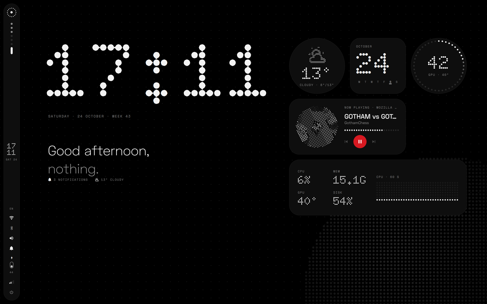
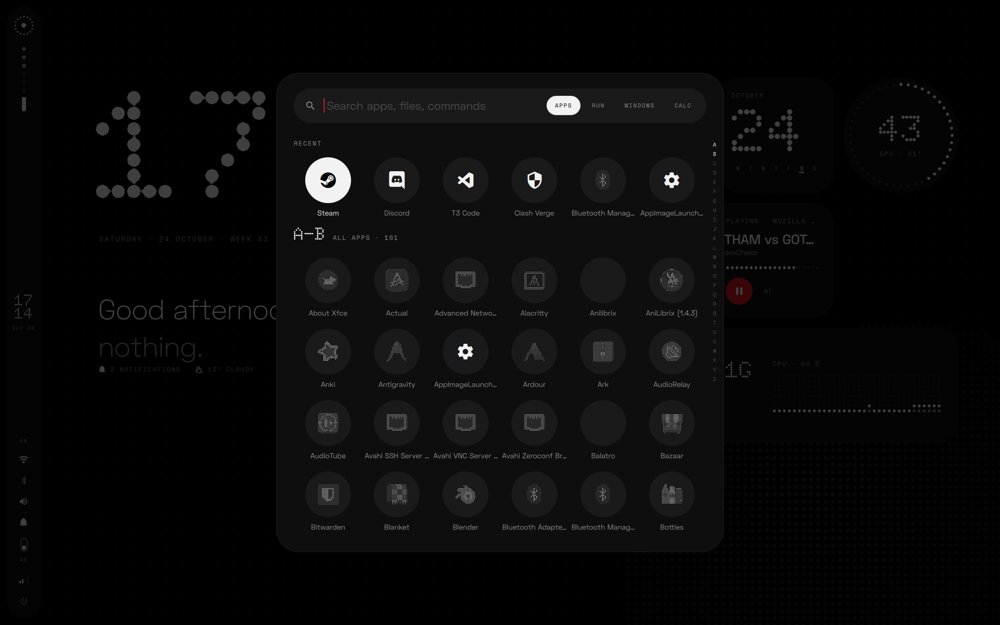
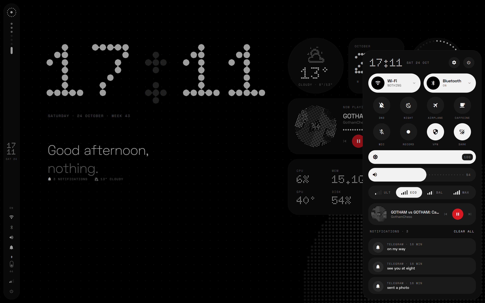
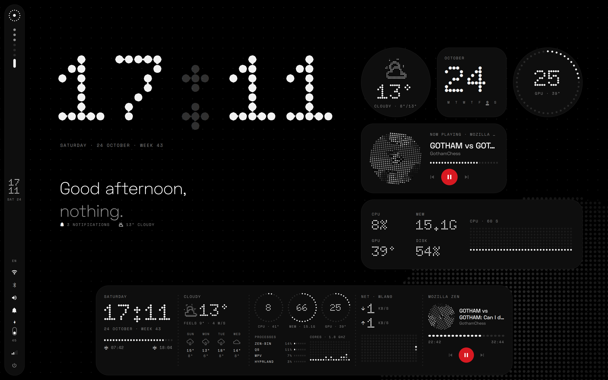
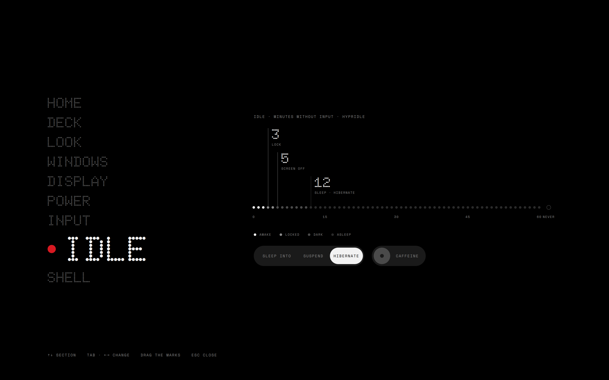
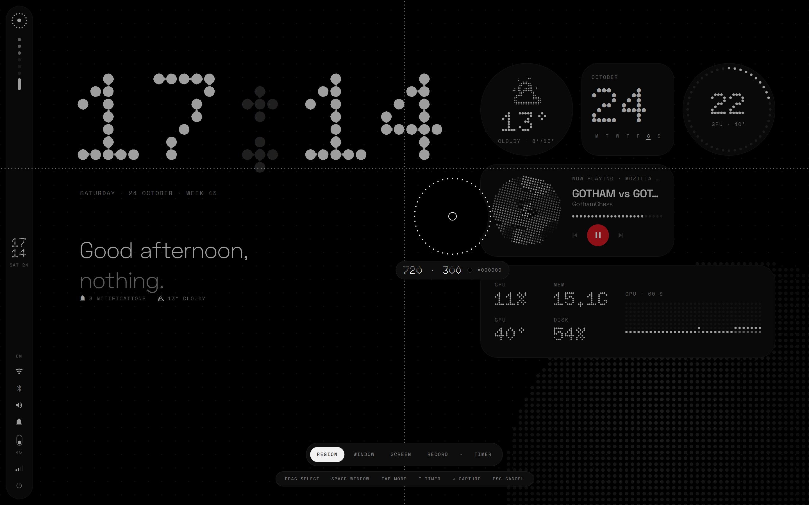
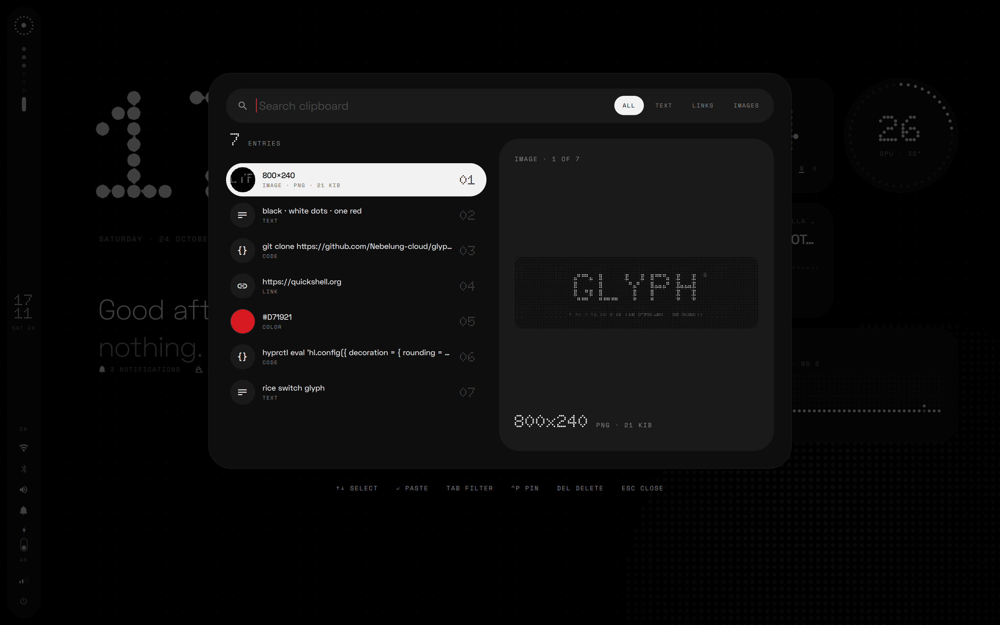
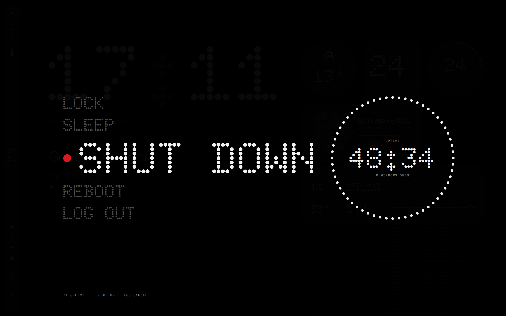
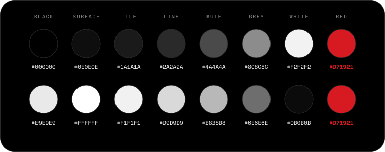

<div align="center">

**Legenda** — Ubuntu edition of the [Glyph rice](https://github.com/Nebelung-cloud/glyph-rice) by
[Nebelung](https://github.com/Nebelung-cloud). Design and configs are his; this fork only adds Ubuntu
packaging. See [CREDITS.md](CREDITS.md).

<br>



</div>

<div align="center"></div>

<h2 align="center">What's inside</h2>

|              |                                                                      |                      |
| ------------ | -------------------------------------------------------------------- | :------------------: |
| **Bar**      | launcher, workspaces, clock, tray                                    |                      |
| **Home**     | clock, greeting, widgets, dot grid                                   |                      |
| **Glyph**    | screen edges as OSD: volume, brightness, notifications, progress     |                      |
| **Launcher** | apps, commands, windows, calculator                                  |       `Super`        |
| **Quick**    | quick settings, media, notifications; also opens from the right edge |     `Super` `A`      |
| **Deck**     | dashboard from the bottom edge                                       |   `Super` `Space`    |
| **Prefs**    | settings                                                             |     `Super` `I`      |
| **Shot**     | screenshots, editor, recording                                       |       `Print`        |
| **Clip**     | clipboard history                                                    |     `Super` `V`      |
| **Charms**   | emoji, kaomoji, symbols                                              |     `Super` `.`      |
| **Walls**    | wallpapers as dots                                                   | `Super` `Shift` `W`  |
| **VPN**      | Clash Verge panel                                                    |     `Super` `P`      |
| **Cal**      | calendar, focus timer                                                |   click the clock    |
| **Buds**     | Nothing / CMF earbuds: battery, ANC                                  |                      |
| **Power**    | power menu                                                           |    `Super` `Esc`     |
| **Lock**     | lock screen                                                          |     `Super` `L`      |
| **Rice**     | shell switcher, if Demon's Shot is installed too                     | `rice switch <name>` |

Also: Hyprland (Lua), hypridle, kitty, fish, starship, fastfetch, btop, cava, GTK, Qt and folder colours.

<div align="center"></div>

<h2 align="center">Screenshots</h2>

|                                                    |                                              |
| :------------------------------------------------: | :------------------------------------------: |
|  **Launcher** |   **Quick**   |
|        **Deck**       |  **Prefs** |
|        **Shot**       |     **Clip**    |
|      **Power**      |                                              |

<div align="center"></div>

<h2 align="center">Install</h2>

```sh
# Ubuntu 24.04+ — one script: Hyprland, Quickshell, Nerd Font, then symlinks
git clone https://github.com/callmidavid/legenda ~/.local/share/legenda
~/.local/share/legenda/install-ubuntu.sh
```

```sh
# Arch: packages, services, symlinks
git clone https://github.com/callmidavid/legenda ~/.local/share/legenda
~/.local/share/legenda/install.sh
```

```sh
# any distro with hyprland + quickshell already installed: symlinks only
~/.local/share/legenda/install.sh --links
```

On Ubuntu the script uses `ppa:cppiber/hyprland` for Hyprland 0.56 and installs Quickshell
through Nix, because 24.04 has no `quickshell` package and its Qt 6.4 is below the required 6.6.
If `cache.nixos.org` is unreachable from your network, point it at a mirror first:

```sh
LEGENDA_NIX_SUBSTITUTERS=https://mirror.sjtu.edu.cn/nix-channels/store ~/.local/share/legenda/install-ubuntu.sh
```

Ubuntu gaps you should know about: `qtengine`/`darkly` (Qt theming) don't exist, `starship`,
`fastfetch`, `swappy` and `gpu-screen-recorder` are not packaged on 24.04. The shell runs without
them — only the fish prompt, the `fastfetch` greeting and the `Super+Alt+R` recording bind are affected.

The lock screen checks passwords through Quickshell's PAM service. Nix's `pam_unix` expects
`/run/wrappers/bin/unix_chkpwd`, so `install-ubuntu.sh` links Ubuntu's setuid
`/usr/sbin/unix_chkpwd` there. Without that link a correct password is rejected with
`PAM_AUTHINFO_UNAVAIL`.

Old configs go to `~/.dots-backup-<date>/`. Wallpapers are read from `~/Pictures/Wallpapers`.

| `config/`                | goes to                                                                                       |
| ------------------------ | --------------------------------------------------------------------------------------------- |
| `hypr/`                  | `~/.config/hypr`                                                                              |
| `quickshell/glyph/`      | `~/.config/quickshell/glyph`                                                                  |
| `quickshell/rice/`       | `~/.config/quickshell/rice`, `~/.local/bin/rice`                                              |
| `quickshell/glyph/term/` | `starship.toml` `fastfetch/` `btop/` `cava/` `gtk-*/gtk.css` `qtengine.colors` in `~/.config` |
| `kitty/` `qtengine/`     | `~/.config/…`                                                                                 |
| `fish/`                  | `~/.config/fish`                                                                              |
| `fonts/`                 | `~/.local/share/fonts/glyph`                                                                  |

Monitor, backlight, GPU and sensors are detected. Keyboard layouts are in `hypr/hyprland/input.lua`,
default apps in `hypr/variables.lua`. Earbuds photo: `quickshell/glyph/buds/<device-name>.png`.
Your own binds and overrides go in `hypr/user.lua`: it's gitignored, so `git pull` never touches it.

<div align="center"></div>

<h2 align="center">Dependencies</h2>

|              |                                                                                                                                                                                           |
| ------------ | ----------------------------------------------------------------------------------------------------------------------------------------------------------------------------------------- |
| **Shell**    | `quickshell` · `hyprland` 0.56+ · `hypridle` · `hyprsunset` · `xdg-desktop-portal-hyprland` · `jq` · `curl` · `python3` · `libqalculate`                                                  |
| **System**   | `networkmanager` · `bluez` · `pipewire` · `wireplumber` · `upower` · `power-profiles-daemon` · `brightnessctl` · `libnotify` · `playerctl` · `polkit-gnome` · `gnome-keyring` · `geoclue` |
| **Capture**  | `grim` · `slurp` · `imagemagick` · `libvips` · `gpu-screen-recorder` · `cliphist` · `wl-clipboard`                                                                                        |
| **Terminal** | `kitty` · `fish` · `starship` · `fastfetch` · `btop` · `cava` · `eza` · `zoxide` · `direnv`                                                                                               |
| **Look**     | `papirus-icon-theme` · JetBrains Mono Nerd Font · Bibata · `qtengine` · `darkly`                                                                                                          |
| **Optional** | `clash-verge-rev` · `nvidia-utils` · `ydotool` · `hyprpicker` · `swappy` · `trash-cli`                                                                                                    |

From the AUR only `qtengine`, `darkly`, Bibata, Zen and Clash Verge, all optional. The VPN panel expects Clash Verge in English.
NixOS: change the `/usr/lib` agent paths in `hypr/hyprland/execs.lua` and the Papirus path in `quickshell/rice/rice`.

<div align="center"></div>

<h2 align="center">Colours</h2>

<div align="center"></div>

<br>

Dark and light. Red marks the one live thing on screen.
Fonts: Doto, Space Grotesk, Space Mono, JetBrains Mono Nerd Font.

<div align="center"></div>

<h2 align="center">Inspiration</h2>

- [**Nothing OS**](https://nothing.tech): the look and the Glyph lights.
- [**Doto**](https://github.com/oliverlalan/Doto): the dot matrix font.
- [**Gadgetbridge**](https://codeberg.org/Freeyourgadget/Gadgetbridge): the earbuds protocol in `glyph/ear`.
- [**Caelestia**](https://github.com/caelestia-dots/shell): the shell I used before; the deck and hardware detection follow it.

<div align="center"></div>

<h2 align="center">License</h2>

[GPL-3.0](LICENSE). Fonts are under the [OFL](config/fonts/OFL.txt), cava shaders keep their MIT headers.

Original Glyph rice by [Nebelung](https://github.com/Nebelung-cloud) — <https://github.com/Nebelung-cloud/glyph-rice>.
Ubuntu packaging by [callmidavid](https://github.com/callmidavid). Details in [CREDITS.md](CREDITS.md).
Nothing, Nothing OS and Glyph are trademarks of Nothing Technology Ltd; this is a fan project, not affiliated with Nothing.

<div align="center"></div>

<div align="center">

```
ᓚᘏᗢ  · · ·
```

```
⠀⠀⠀⠀⣰⣶⣦⣄⡀⠀⠀⠀⠀⠀⠀⠀⠀⠀⠀⠀⠀⠀⠀⢀⣤⣶⣶⡆⠀⠀⠀⠀
⠀⠀⠀⢠⣿⣿⣿⣿⣿⣦⡀⠀⠀⠀⠀⠀⠀⠀⠀⠀⠀⣠⣶⣿⣿⣿⣿⣿⠀⠀⠀⠀
⠀⠀⠀⢸⣿⣿⣿⣿⣿⣿⣿⣦⡀⠀⠀⠀⠀⠀⠀⢀⣾⣿⣿⣿⣿⣿⣿⣿⡆⠀⠀⠀
⠀⠀⠀⢸⣿⣿⣿⣿⣿⣿⣿⣿⣿⣄⣀⣀⣀⣀⣰⣿⣿⣿⣿⣿⣿⣿⣿⣿⡇⠀⠀⠀
⠀⠀⠀⢸⣿⣿⣿⣿⣿⣿⣿⣿⣿⣿⣿⣿⣿⣿⣿⣿⣿⣿⣿⣿⣿⣿⣿⣿⡇⠀⠀⠀
⠀⠀⠀⠸⣿⣿⣿⣿⣿⣿⣿⣿⣿⣿⣿⣿⣿⣿⣿⣿⣿⣿⣿⣿⣿⣿⣿⣿⠁⠀⠀⠀
⠀⠀⠀⠀⢿⣿⣿⣿⣿⣿⡿⢿⣿⣿⣿⣿⣿⣿⣿⣿⠿⣿⣿⣿⣿⣿⣿⡏⠀⠀⠀⠀
⠀⠀⠀⠀⣼⣿⣿⣿⣿⡏⠀⠀⢹⣿⣿⣿⣿⣿⣿⠃⠀⠀⣿⣿⣿⣿⣿⣆⠀⠀⠀⠀
⠀⠀⠀⣸⣿⣿⣿⣿⣿⣷⣀⣀⣼⣿⣿⣿⣿⣿⣿⣦⣀⣠⣿⣿⣿⣿⣿⣿⡆⠀⠀⠀
⣀⣠⣤⣿⣿⣿⣿⣿⣿⣿⣿⣿⣿⣿⣿⣿⣿⣿⣿⣿⣿⣿⣿⣿⣿⣿⣿⣿⣷⣤⣀⡀
⠻⠿⠛⣿⣿⣿⣿⣿⣿⣿⢿⣿⣿⣿⣷⠀⢀⣿⣿⣿⣿⣿⣿⣿⣿⣿⣿⣿⡟⠛⠿⠇
⠀⢀⣠⣾⣿⣿⣿⣿⣿⣿⡈⢿⣿⣿⣿⠃⠸⣿⣿⣿⡿⢰⣿⣿⣿⣿⣿⣿⣷⣄⠀⠀
⠀⢿⠿⠋⢻⣿⣿⣿⣿⣿⣷⣄⣉⣉⣡⣾⣧⣈⣉⣉⣴⣿⣿⣿⣿⣿⣿⠏⠙⢿⡗⠀
⠀⠀⠀⠀⠀⠻⣿⣿⣿⣿⣿⣿⣿⣿⣿⣿⣿⣿⣿⣿⣿⣿⣿⣿⣿⣿⠏⠀⠀⠀⠀⠀
⠀⠀⠀⠀⠀⠀⠈⠻⣿⣿⣿⣿⣿⣿⣿⣿⣿⣿⣿⣿⣿⣿⣿⡿⠟⠁⠀⠀⠀⠀⠀⠀
⠀⠀⠀⠀⠀⠀⠀⠀⠀⠉⠛⠻⠿⢿⣿⣿⣿⣿⠿⠿⠟⠛⠉⠀⠀⠀⠀⠀⠀⠀⠀⠀
```

</div>
